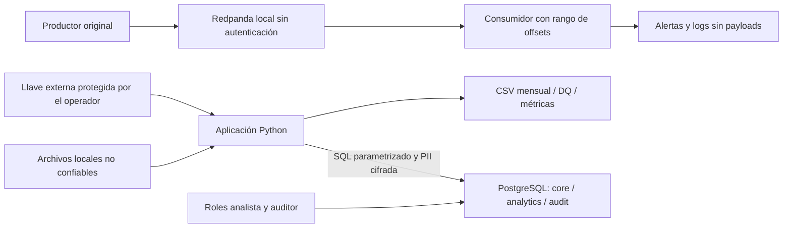

# Modelo de amenazas — Bia Energy

## Alcance y fronteras de confianza

Fronteras: archivos/proceso, archivo de llave/proceso, cuentas SQL/base, aplicaciones/broker y proceso/archivos publicados. Un administrador del host o del motor queda fuera de las garantías de inmutabilidad operativa. AWS es únicamente diseño Terraform, sin conexión implementada con este flujo.

Activos: llave y PII (`Restringido-PII`); consumos/facturas/cuarentena (`Confidencial` o campo restringido según política); identificadores y auditoría técnica (`Interno`). Un dump no debe revelar los campos restringidos; perder la llave puede impedir recuperarlos.

## Amenazas concretas

STRIDE: S suplantación; T manipulación; R repudio; I divulgación; D denegación de servicio; E elevación de privilegios. Probabilidad/impacto: B baja, M media, A alta. El mapeo ISO es de referencia, no certificación ni declaración de cumplimiento integral.

| ID / STRIDE | Amenaza | P / I | Control y evidencia real | Estado / riesgo residual | Anexo A |
|---|---|---|---|---|---|
| T1 / S | Robo de credenciales locales para suplantar ingesta | M / A | Generación nueva/conservación explícita; SCRAM, cuentas separadas, loopback. `tools/manage.py`, SQL 001; `test_access.py` | Parcial: ACL Windows y compromiso del host dependen del operador | A.5.17 |
| T2 / T | SQL incrustado en maestro elimina consumos | M / A | CSV completo y SQL parametrizado; `client_service.ingest_bytes`, `load.py`; T03 con BD aislada | Implementado para rutas actuales; no ejecutar entradas como comandos | A.8.28 |
| T3 / R | Ingesta altera auditoría o atribuye acciones a otra cuenta | M / A | DML revocado; función con actor de sesión y search_path fijo. SQL 001; `test_T19_audit_is_insert_only_via_function` | Parcial: superusuario puede alterar auditoría; caída de BD puede impedir registrar fallo | A.5.18 |
| T4 / I | Dump de PostgreSQL revela PII de clientes/facturas/rechazos | M / A | Fernet previo a SQL y llave externa; `Cipher`, SQL 002/004; T17 y pruebas de facturación | Implementado en campos clasificados; proceso con llave y originales siguen siendo sensibles | A.8.24 |
| T5 / T | Intercambiar ciphertext entre columnas/clientes | M / A | Contexto dentro del mensaje autenticado y verificación al abrir; `Cipher.open`; T17 de contexto | Implementado; no protege frente a un atacante que controla proceso y llave | A.8.24 |
| T6 / E | Analista lee tablas privadas o modifica hechos | M / A | Roles sin propiedad ni escalamiento; solo vistas. SQL 001–004 y T18 con conexiones reales | Implementado para modelo actual; revisar grants en futuros cambios | A.8.3 / A.5.18 |
| T7 / I | Una columna nueva o error del driver filtra PII en logs/out | M / A | Clasificación activa, mensajes cerrados, selección de campos; T15/T26 y `test_quality.py` | Parcial: heurísticas no detectan toda PII; logs ordinarios no son inmutables | A.5.12 / A.8.28 |
| T8 / D | Archivo gigante o broker detenido bloquea la ejecución | M / A | Timeouts y cierre de subprocesos/Kafka; transacción por archivo, errores explícitos y T31 | Parcial: no hay límite general de memoria/tamaño; CSV/JSON se materializan completos | A.8.6 |
| T9 / S,T | Otro proceso local inyecta eventos durante el replay | M / A | Loopback, rango de offsets, comparación de cantidad y campos válidos; T25 | Parcial: sin SASL/TLS; se presupone único productor. Un conteo coincidente no autentica origen | A.5.15 / A.8.3 |
| T10 / T | Fallo entre reemplazos deja salidas de distintas ejecuciones | M / M | Archivos completos con reemplazo individual, retorno de error y regeneración idempotente; `publish_files`, T32 | Parcial: sin transacción conjunta entre archivos, SQL y Kafka | A.8.28 |

Los estados implementados se apoyan en código/pruebas; las 43 pruebas y el replay reproducible fueron confirmados por el responsable en Windows. S06 no los vuelve a ejecutar ni convierte esa evidencia en una garantía absoluta.

## Riesgos aceptados y propuesta AWS

Entorno local de evaluación, sin endurecimiento de producción: confianza en host/administradores, Kafka sin autenticación, detección de PII heurística, sin rotación automática Fernet ni aislamiento ante productores concurrentes. No se implementaron alertas operativas continuas, copias de respaldo/restauración automatizadas ni protección WORM.

`infra/main.tf` reduce exposición pública y separa permisos S3/KMS por prefijo, **solo como código no desplegado**. No corrige estos riesgos locales. KMS administrativo puede modificar su política; S3 versionado permite sobrescribir claves y no reemplaza auditoría SQL. Antes de producción harían falta requisitos operativos y una evaluación nueva, no solo ejecutar este Terraform.

## Referencias del mapeo

Nombres de controles usados: A.5.12 clasificación; A.5.15 control de acceso; A.5.17 información de autenticación; A.5.18 derechos de acceso; A.8.3 restricción de acceso a información; A.8.6 capacidad; A.8.24 criptografía; A.8.28 codificación segura. La asociación amenaza/control es nuestro análisis.

Referencia normativa: [ISO/IEC 27001:2022](https://www.iso.org/standard/82875.html), Anexo A, tabla A.1; correspondencia de numeración y títulos contrastada con los extractos indexados de la [copia normativa de referencia UPM](https://eiso.upm.edu.my/portal/standard%20ISO/ISO%20IEC%2027001-2022%20%7Bed3.0%7D%20UPM.pdf). No se reproducen cláusulas de la norma. La descarga íntegra de esa copia no estuvo disponible durante S06; este documento no sustituye una revisión de conformidad.
